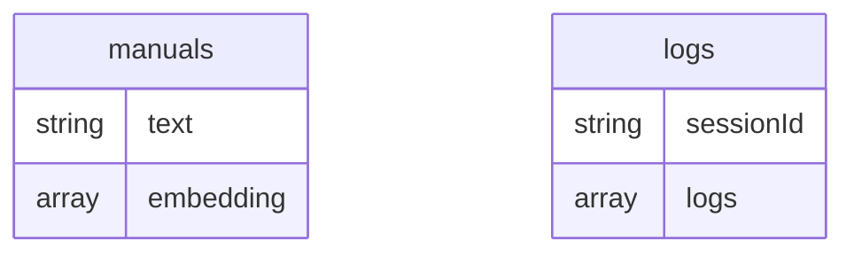

# EDD — Entity Document Diagram

MongoDB data model for the GenAI-Powered In-Car Voice Assistant.

Database: configurable via `DATABASE_NAME` (`car_assistant_demo` in the example
`.env.local`). All access goes through the single client in
`src/lib/mongodb/vectorSearch.js`, including the generic `/api/action/[action]` proxy
used by the frontend.

Vehicle state (warning lights, DTC codes, `SAMPLE_CONVERSATION`) is hardcoded in
`src/lib/const.js` and is **not** stored in MongoDB — only car manual content and chat
logs are.

---

## Entity overview

| Collection | Written by | Read by | Vector index |
| --- | --- | --- | --- |
| `manuals` | `scripts/seed-manuals.js` | `vectorSearch()` in `src/lib/mongodb/vectorSearch.js`, called from the `consultManual` function in `src/app/api/gcp/chat/route.js` | `manual_vector_index` |
| `logs` | `useChat.js`'s `addLog()`, via `POST /api/action/updateOne` | `LogConsole.js`, via `POST /api/action/findOne` | none |

## `manuals`

One document per car manual chunk. Field types below are sampled from a live document
inserted by `scripts/seed-manuals.js`.

| Field | Type | Notes |
| --- | --- | --- |
| `_id` | ObjectId | |
| `text` | string | The manual excerpt returned to the LLM as `consultManual`'s function response |
| `embedding` | array\<double\>, len=768 | `text-embedding-005` (or whatever `VERTEXAI_EMBEDDINGS_MODEL` was set to at seed time), `taskType: RETRIEVAL_DOCUMENT` |

Vector index (`manual_vector_index`, confirmed `READY`/queryable on the seeded cluster):

| Path | Type | Dimensions | Similarity |
| --- | --- | --- | --- |
| `embedding` | vector | 768 | cosine |

⚠️ This index is not created by any script — see README Quick Start step 2. If it's
missing, `$vectorSearch` in `vectorSearch()` fails and `consultManual` returns nothing.

## `logs`

One document per chat session, accumulating a log entry per tool call. Not yet sampled
live (empty in the seeded database at documentation time) — the shape below is derived
from `useChat.js`'s `addLog()` and `LogConsole.js`'s read.

| Field | Type | Notes |
| --- | --- | --- |
| `_id` | ObjectId | |
| `sessionId` | string | Matches the chat session id from `ChatSessionContext` |
| `logs` | array\<object\> | Appended to via `$push`; each entry: `{ timestamp: ISO string, toolName: string, type: "call", details: object }` |

No index beyond `_id` — lookups filter on `sessionId`, which has no dedicated index.

---

## Relationships

All relationships are **logical only** — no foreign keys, no validators, no indexes
beyond `_id` and `manual_vector_index`. `manuals` and `logs` are unrelated collections;
nothing joins them.

## Known inconsistencies

1. **`logs` has no schema validation and no index on `sessionId`.** Every read
   (`LogConsole.js`, polled every 3 seconds) does a full collection scan filtered by
   `sessionId`. Fine at demo scale; would need an index if this collection grew.
2. **The embeddings model is not pinned per-document.** `manuals` documents don't record
   which model or dimensionality produced their `embedding`. If `VERTEXAI_EMBEDDINGS_MODEL`
   changes without re-seeding, `manual_vector_index` (768 dims) will silently mismatch
   any newly-inserted documents embedded at a different dimensionality.

Update this section if either is fixed — otherwise it becomes misleading.
